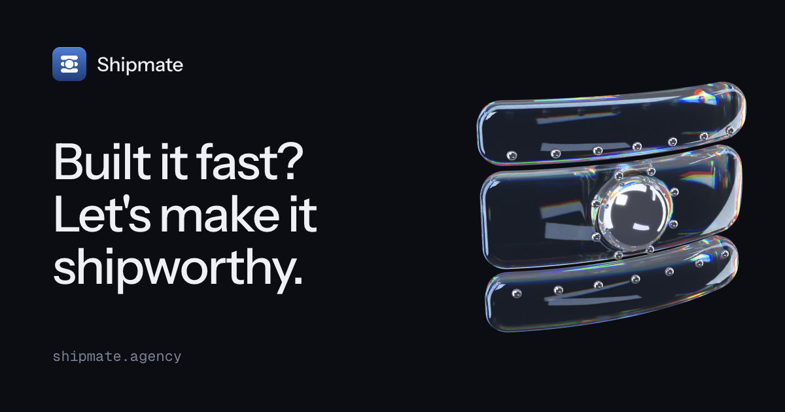

  

<h1 align="center">Shipmate — Vibe-Code, AI & SaaS Web App Security</h1>

  
  
  
  

**Shipmate** ([shipmate.agency](https://shipmate.agency)) finds security holes in web applications built fast with **Cursor, Lovable, Bolt, v0, Replit, Next.js, Supabase, and Stripe**, then ships the fixes as **one clean pull request** that your team reviews and merges. Every finding is verified by a human researcher — not dumped from an automated scanner.

The tool and template repositories in this organization are **free and open source (MIT)**. The CLI and MCP server run locally and send no telemetry; the CLI only makes network requests in its URL and Supabase modes. Use our CLI, MCP server, SQL audit queries, and compliance templates before your next launch, enterprise security questionnaire, or SaaS acquisition due diligence.

---

## Flagship Security Tools & Benchmarks

| Repository | Purpose | Stack / Use Case |
|---|---|---|
| **[`shipready`](https://github.com/Shipmate-agency/shipready)** | Zero-dependency pre-launch security CLI & GitHub Action (SARIF output, 14 rules) | Next.js, Supabase, Stripe, Headers |
| **[`shipready-mcp`](https://github.com/Shipmate-agency/shipready-mcp)** | Local stdio MCP server + `.cursorrules` / `rules/*.mdc` / `CLAUDE.md` guardrails | Cursor, Claude Code, Windsurf |
| **[`awesome-vibe-code-security`](https://github.com/Shipmate-agency/awesome-vibe-code-security)** | Curated open-source directory of AI-app security scanners, guides & standards | Vibe-coding, AppSec, OWASP |
| **[`vibe-vuln-bench`](https://github.com/Shipmate-agency/vibe-vuln-bench)** | Standardized multi-tenant SaaS prompt & 10-check static security grader | Lovable, Bolt, Cursor, v0, Replit |

## Free Copy-Paste Templates & Audit Kits

| Repository | What It Unblocks | Related Guide |
|---|---|---|
| **[`pentest-attestation-letter-template`](https://github.com/Shipmate-agency/pentest-attestation-letter-template)** | Buyer-ready Markdown Penetration Test Letter of Attestation | [Live Sample Letter](https://shipmate.agency/sample-letter) |
| **[`startup-security-questionnaire-answers`](https://github.com/Shipmate-agency/startup-security-questionnaire-answers)** | Honest starter answers to 18 common SIG Lite / VSA questions | [Interactive Questionnaire Kit](https://shipmate.agency/tools/questionnaire-kit) |
| **[`supabase-rls-audit-pack`](https://github.com/Shipmate-agency/supabase-rls-audit-pack)** | 1-query Postgres SQL audit for `rls_disabled_in_public`, `USING (true)` & `security_definer_view` | [Supabase RLS Fix Guide](https://shipmate.agency/articles/supabase-rls-disabled-in-public-fix) |
| **[`stripe-webhook-audit-nextjs`](https://github.com/Shipmate-agency/stripe-webhook-audit-nextjs)** | Verified Next.js App Router Stripe webhook handler (`constructEvent` on raw body) | [Stripe Signature Error Fix](https://shipmate.agency/articles/stripe-webhook-signature-error-fix) |

---

## When Automated Checks Are Not Enough

Static scanners catch known patterns, not business-logic IDOR, multi-tenant authorization bypasses, or billing edge cases.

| Tier | Price | What You Get |
|---|---|---|
| **Free Check** | **$0** (no card) | Passive surface check of public pages & JS bundle, emailed within ~2 days ([Request free check](https://shipmate.agency/check)) |
| **Launch Lockdown** | **$950 once** | Human code + staging review across 8 security areas, fixes in 1 PR, re-check after merge, 15-min call |
| **Pentest + Letter** | **$2,950 once** | Everything in Lockdown + hands-on penetration test + dated 1-page attestation letter ([View sample](https://shipmate.agency/sample-letter)) |

- **Testing requires written owner permission** — nothing destructive is run on live customer data.
- **Partners:** white-label reviews for agencies, 20% of each referred job for SOC 2 consultants and others who make intros, and a free founder perk investors and accelerators can list. Details at [shipmate.agency/partners](https://shipmate.agency/partners).
- **Contact:** [hello@shipmate.agency](mailto:hello@shipmate.agency) · [shipmate.agency](https://shipmate.agency)
